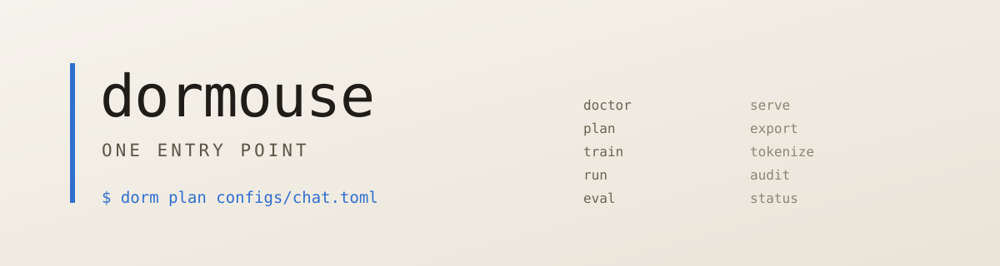

<p align="center">
  
</p>

<p align="center">
  <a href="https://github.com/dormouse-ai/dormouse/actions/workflows/ci.yml"></a>
  <a href="LICENSE"></a>
  
</p>

**A language model you own rather than rent.** Weights under Apache-2.0, small
enough to ship as a file, fast enough to run on a laptop, trained on one consumer
GPU so the whole recipe stays checkable.

This repository is the engine and its single entry point.

[Русский](#русский) · [Commands](#commands) · [State](#what-is-real-today) · [Layout](#layout) · [Install](#install)

---

## Commands

```
dorm doctor                    what this machine can do
dorm plan   <config>           what will run, and what it will cost
dorm train  <config> [--yes]   training; past the budget --yes is required
dorm run    <config>           pretrain → sft → eval → export
dorm tokenize <corpus>         text → token ids, with a manifest
dorm eval   <ckpt>             BPB and downstream, one harness
dorm serve  <ckpt>             OpenAI-compatible server
dorm export <ckpt>             quantised package + round-trip check
dorm audit  <config>           invariants: flags reported, gradients flow, shapes agree
dorm status [journal]          read a run journal
```

### Why one binary instead of scripts

Three measurements in this project were invalidated by a shell script that exited
`0` after doing nothing, and two more by output piped through `grep`, which hid the
line that mattered. So:

* **no silent success** — a command that is not wired refuses with an escape and a
  non-zero exit code;
* **no surprise cost** — anything predicting more than the approval budget needs
  `--yes`;
* **no log grepping** — a run writes a journal; `status` reads it.

```console
$ dorm serve runs/smoke/final.pt
serve is not wired yet. Escape: port/ serve for now; the Rust binary arrives in step 7
$ echo $?
2
```

## What is real today

| | status |
|---|---|
| `doctor`, `status`, `plan` | working, tested |
| `train` | working: model, mixture, optimizer, schedule, journal, checkpoint, eval, artifact |
| `eval` | working: the five-task harness and BPB with its byte window |
| `data/bin.py`, `data/mix.py` | working: memory-mapped streams, exact shares, resume by arithmetic |
| `metrics.py` | working: BPB is a type that cannot exist without its evaluation window |
| `model/` | the one 1B/46M stack, priced on the meta device and assembled from the spec |
| `run`, `serve`, `export`, `tokenize` | refuse by design until the layer behind them moves |

The old research stack lives in [sehaxe/dormouse](https://github.com/sehaxe/dormouse)
as an archive; nothing here imports it.

## Layout

```
src/dormouse/
  cli.py        one entry point
  metrics.py    BPB as a type
  data/bin.py   token stream with a manifest
  train/        the loop, its recipe, its guards — and entry.py, the one command
  model/        ffn, attn, blocks, model
```

Import boundaries are checked by a linter: `data/` may not import `model/`,
`model/` may not import training. A violation is a red build.

## Install

```bash
python -m venv .venv && .venv/bin/pip install -e '.[dev]'
.venv/bin/dorm doctor
.venv/bin/python -m pytest
```

CPU-only torch is enough for the tests:

```bash
pip install torch --index-url https://download.pytorch.org/whl/cpu
```

## Design rules

1. **Numbers or it did not happen** — every mechanism ships with the measurement
   that justifies it, or is recorded as a refusal with the number.
2. **External anchors** — a numeric mechanism is checked against a reference
   computed outside this repository (numpy, a closed form, a paper's formula). A
   golden hash captured from our own run is a lint error.
3. **One concept per module**, and a line ceiling that is a budget, not a wish.
4. **Hot swap with a receipt** — a component can be replaced at a stage boundary,
   and the swap is a journal event carrying its step number. Nothing is replaced
   silently.

## License

Apache-2.0.

---

# Русский

**Языковая модель, которой вы владеете, а не арендуете.** Веса под Apache-2.0,
достаточно маленькие, чтобы быть файлом, достаточно быстрые для ноутбука,
обученные на одной потребительской видеокарте — чтобы весь рецепт можно было
проверить.

Этот репозиторий — движок и единственная точка входа.

## Команды

```
dorm doctor                    что умеет эта машина
dorm plan   <config>           что будет запущено и сколько это стоит
dorm train  <config> [--yes]   обучение; дороже бюджета — нужен --yes
dorm run    <config>           pretrain → sft → eval → export
dorm tokenize / eval / serve / export / audit / status
```

### Почему один бинарь, а не скрипты

В этом проекте три замера были испорчены скриптом, который завершился с кодом
`0`, ничего не сделав, и ещё два — выводом, ушедшим в `grep`, где потерялась
нужная строка. Поэтому:

* **никакого тихого успеха** — команда, которая не подключена, отказывается с
  текстом выхода и ненулевым кодом;
* **никакой внезапной цены** — то, что обещает больше бюджета, требует `--yes`;
* **никакого поиска по логам** — прогон пишет журнал, `status` читает его.

## Что реально работает сейчас

| | статус |
|---|---|
| `doctor`, `status` | работают, покрыты тестами |
| `data/bin.py` | поток токенов через memmap, проверка манифеста, resume арифметикой |
| `metrics.py` | BPB — тип, который не может существовать без окна оценки |
| `model/` | трансформер, gated FFN, внимание с RoPE — каждый сверен с numpy-референсом, а не со старым кодом |
| остальное | отказывается по замыслу, пока не перенесён слой |

Старый исследовательский стек лежит в
[sehaxe/dormouse](https://github.com/sehaxe/dormouse) как архив; этот репозиторий
его не импортирует.

## Установка

```bash
python -m venv .venv && .venv/bin/pip install -e '.[dev]'
.venv/bin/dorm doctor
.venv/bin/python -m pytest
```

## Лицензия

Apache-2.0.
