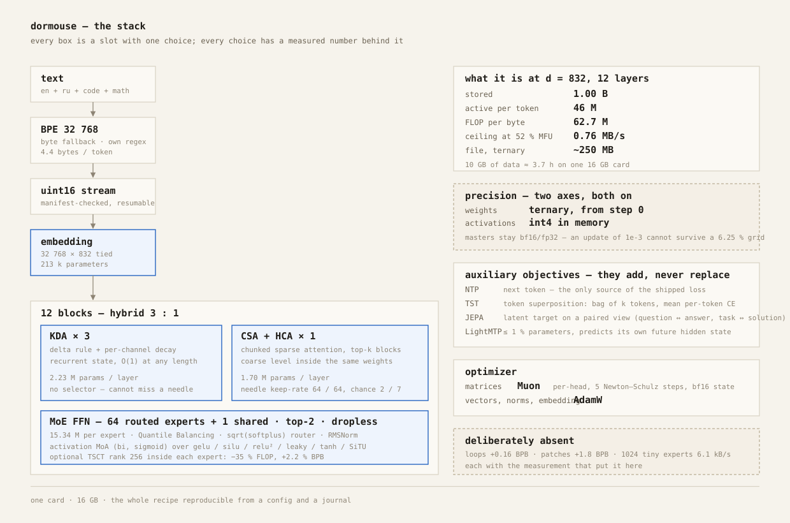

# Architecture

One card, 16 GB, and a model that is small enough to ship as a file. Every box
below is a **slot** — one choice per slot — and every choice has a measurement
behind it. Where a mechanism is absent, the number that removed it is named.

<p align="center"></p>

## The stack

| layer | what | why this |
|---|---|---|
| unit | BPE 32 768, byte fallback | 4.4 bytes per token against 1 for bytes: 3.4× fewer steps at equal text; tokens win in the low-FLOP regime (arXiv 2609.12303) |
| embedding | 32 768 × 832, **tied** to the head | the read and write of a token belong in one matrix; tying saves 27 M parameters |
| attention | **3 KDA : 1 CSA**, per 4 layers | KDA is a recurrent state with a delta rule — O(1) memory and no selector that can miss; the sparse layer adds reach |
| FFN | **MoE, 64 experts × 15.34 M + 1 shared, top-2, dropless** | 1 B of capacity at 46 M active: the only way to buy knowledge without buying FLOPs |
| activation | **MoA** (bi-sided, sigmoid gate) over `gelu, silu, relu², leaky, tanh, SiTU` | token-adaptive mixing measured −0.029 relative loss against SwiGLU at 0.12 B–2 B (arXiv 2605.26647), for O(d) parameters |
| loss | chunked cross-entropy | a `[T, 32768]` logits tensor is 1.6 GB at b24; chunking removes it (measured 13.3×) |
| optimizer | **Muon** for matrices, **AdamW** for vectors/norms | 1.35× fewer steps to the same loss; Newton–Schulz is 13 % of our step |
| precision | **ternary weights from step 0**, **int4 activations in memory**, bf16/fp32 masters | the shipped file is the trained file; masters stay wide because an update of 1e-3 cannot survive a 6.25 % grid |
| head | tied, vocab 32 768 | — |

## The block, drawn

```
x ──► RMSNorm ──► KDA | CSA ──► + ──► RMSNorm ──► MoE ──► +
                     ▲                              ▲
                 RoPE-free                     router: sqrt(softplus)
                 (recurrent state)             top-2 of 64, dropless
                                               QB keeps load within ±5 %
```

Three of every four blocks use KDA; the fourth uses CSA with a coarse (HCA)
level inside the same weights. The pattern is a config value (`attn=hybrid`,
`attn_pattern="3:1"`), and an untileable pattern is refused with the remainder
named.

## Sizes, honestly

| | value | how |
|---|---:|---|
| stored parameters | 1.00 B | 3·832·6144 = 15.34 M per expert × 64 + one shared |
| active per token | 46 M | top-2 routed + shared |
| FLOP per byte | 62.7 M | 6 × 46 M ÷ 4.4 bytes-per-token |
| throughput ceiling | 0.76 MB/s | at 92 TFLOP/s peak and 52 % measured MFU |
| data for 10 GB | ≈ 3.7 h | at the ceiling |
| file, ternary | ≈ 250 MB | 1.585 bits per weight |

## Auxiliary objectives — they add, they never replace

| head | what it predicts | cost | status |
|---|---|---|---|
| **NTP** | the next token | — | the only source of the shipped loss |
| **TST** | the mean per-token CE over a bag of `k` glued tokens | 0 extra parameters | implemented; measured negative at 95 M **with a loss the paper rejects** — being re-run |
| **JEPA** | the embedding of a paired view (question ↔ answer) | +28 % step (second forward) | not in v1; the pair-free variant needs a diffusion backbone, which is not this model |
| **LightMTP** | its own hidden state `h` steps ahead, stop-gradient | ≤1 % parameters | implemented; A/B pending |

The rule for all three: an auxiliary objective is enabled only if it survives the
eight checks in `plan/NEGATIVE_RESULTS.md` — counters, gradient, config reached
the code, fair comparison, init, finite numbers, tuned lr, matches its paper.

## What is deliberately absent

| mechanism | number that removed it |
|---|---|
| looped depth | +0.087 … +0.164 BPB at 1.24–4.9× the compute |
| byte patches | +1.8 BPB at equal bytes |
| 1024 tiny experts | 6.1 kB/s against 87 for dense — and loss 8.37 |
| SIGReg in its first form | +0.148 BPB, 67 % of the term a constant |
| rank-64 TSCT | +28.4 % BPB; rank 256 is the usable point at +2.2 % |

Each of these is a **measured refusal**, not a preference: re-open one only with a
new number, and only after the eight checks.

## Reproducing a run

```
dorm plan configs/kitchen_sink.toml    # what will run, what it will cost
dorm train configs/kitchen_sink.toml   # writes runs/<id>/run.jsonl
dorm status runs/<id>/run.jsonl        # reads the journal, not the stdout
```

The journal records every counter, the effective config hash, and every component
swap with the step it happened at — so a run that was changed mid-flight is still
one reproducible artifact.
